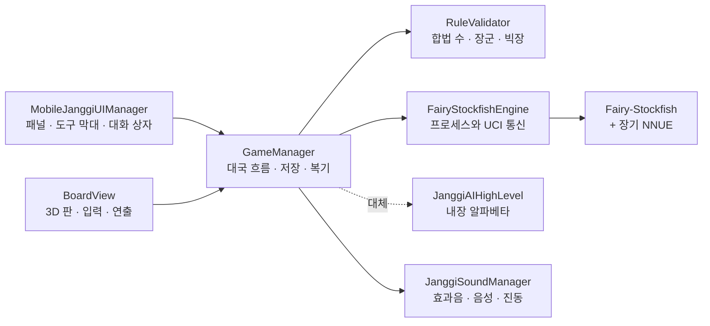

<div align="center">

# 성원장기 (Seongwon Janggi)

**Fairy-Stockfish와 장기 신경망을 AI 상대로 쓰는 안드로이드용 3D 장기 앱**

[English](README.md) | **한국어**

[](https://github.com/id4erich/Janggi/releases/latest)
[](https://github.com/id4erich/Janggi/actions/workflows/rule-check.yml)
[](LICENSE)
<br>
[](https://unity.com/)
[](https://learn.microsoft.com/dotnet/csharp/)
[](https://docs.unity3d.com/Packages/com.unity.render-pipelines.universal@latest)
[](https://github.com/id4erich/Janggi/releases/latest)
[](https://github.com/fairy-stockfish/Fairy-Stockfish)

&nbsp;
&nbsp;


</div>

## 목차

- [핵심 특징](#핵심-특징)
- [내려받기](#내려받기)
- [기능](#기능)
- [구조](#구조)
- [폴더 구조](#폴더-구조)
- [시작하기](#시작하기)
- [테스트](#테스트)
- [도구](#도구)
- [엔진 빌드](#엔진-빌드)
- [개인정보](#개인정보)
- [라이선스](#라이선스)

## 핵심 특징

- **강하고 조절되는 AI**: Fairy-Stockfish와 장기 신경망(NNUE)이 기기 안에서 수를 읽습니다. 입문자용 1단부터 엔진 최대 실력인 9단까지 고를 수 있습니다.
- **실제 장기 같은 손맛**: 나무판 위 3D 회양목 말, 내려놓을 때 나무 소리와 진동, 끌어서 두기와 누르고 두기
- **공부에 좋은 기능**: 힌트, 국면마다 엔진 추천 수를 보는 복기, 공유할 수 있는 기보
- **검증된 규칙**: 규칙 엔진을 CI에서 Fairy-Stockfish의 수 생성과 대조
- **개인정보 보호와 무료**: 광고·회원 가입이 없고, 인터넷으로 아무것도 보내지 않음

## 내려받기

최신 APK는 [**Releases**](https://github.com/id4erich/Janggi/releases/latest)에서 받습니다. Android 7.1 이상, arm64 기기가 필요합니다. 설치하려면 브라우저나 파일 관리자에 "출처를 알 수 없는 앱 설치"를 허용합니다.

## 기능

### 규칙
- 한국 장기 규칙. 궁성 대각선 이동 포함(궁·사·차·포·졸)
- 자기 궁을 장군 상태로 두는 수는 둘 수 없고, 외통이면 대국이 끝남
- 한수 쉼, 무르기, 기권
- 규칙 3종. AI도 같은 규칙으로 두도록 Fairy-Stockfish의 장기 변형과 1:1로 맞춤

  | 규칙 | 엔진 변형 | 빅장(두 궁이 마주 봄) | 연속 한수 쉼 |
  |---|---|---|---|
  | 일반 | `janggicasual` | 규칙 아님 | 무승부 |
  | 빅장 무승부 | `janggitraditional` | 풀어야 하고, 한수 쉼으로 받아들이면 무승부 | 무승부 |
  | 대회 | `janggi` | 대국 종료, 점수 판정 | 대국 종료, 점수 판정 |

  대회 점수: 차 13, 포 7, 마 5, 상 3, 사 3, 졸 2. 한에 1.5점 덤
- 한 수 제한 시간(제한 없음 / 30초 / 60초). 시간을 넘기면 시간패

### 대국 방식과 차림
- AI와 초로 두기, 한으로 두기(판이 돌아가 내 진영이 아래), 한 기기에서 둘이서 두기
- 마상 차림 4종을 초·한 각각 선택
- AI 1~9단. 9단은 엔진 최대 실력

### AI
- [Fairy-Stockfish](https://github.com/fairy-stockfish/Fairy-Stockfish)를 별도 프로세스로 띄워 UCI로 수를 주고받음
- [Fairy-Stockfish-NNUE](https://github.com/fairy-stockfish/Fairy-Stockfish-NNUE)의 장기 신경망으로 국면을 평가
- CPU 코어 절반(최대 4개)과 해시 64MB 사용
- 단계별 대체: 신경망을 못 읽으면 기본 평가로, 엔진을 실행할 수 없으면 내장 알파베타 AI로 둠. 대국 중 엔진이 멈추면 한수 쉼 대신 내장 AI가 이어서 둠
- AI가 생각하는 동안 패널 아래 금색 막대가 차오르고, 둘 말을 금색 고리와 함께 들어 보인 뒤 둠

### 두기
- 말을 누르고 갈 칸을 누르거나, 말을 끌어다 놓기
- 판에 닿는 순간 나무 소리와 진동, 거리에 따라 다른 이동 속도, 잡힌 말은 밀려나며 사라짐
- 못 가는 칸이면 말이 흔들리고 짧게 진동
- 장군을 받으면 궁에 붉은 고리, 힌트 버튼은 엔진 추천 수를 표시
- 잡은 말은 잡은 쪽 대국자 패널에 작은 말 그림으로 표시

### 복기와 기록
- 진영·기물·좌표·잡은 말이 담긴 기보
- 안드로이드 공유 창으로 기보를 글로 공유
- 복기: 한 수씩 앞뒤로 넘겨 보며 국면마다 엔진 추천 수 확인
- 두던 대국은 수마다 저장되어 앱을 다시 켜면 이어서 둠(무르기 기록 포함)
- AI와 둔 판의 전적(둘이서 둔 판은 제외). 설정에서 초기화

### 화면과 소리
- 모따기한 8각 회양목 말과 음각 붓글씨, 나뭇결 장기판, 부드러운 그림자
- 화면 폭을 채우는 바로 위 시점과 비스듬한 입체 시점("시점" 버튼)
- 효과음·음성 대사·진동을 각각 켜고 끔. "장이야!" 같은 음성 대사는 기기의 TextToSpeech로 재생(오프라인)

## 구조



엔진은 PC에서는 `System.Diagnostics.Process`, 안드로이드에서는 `Runtime.exec`로 실행합니다. 요청은 백그라운드 스레드에서 처리해 AI가 생각하는 동안에도 화면이 멈추지 않습니다.

## 폴더 구조

| 경로 | 내용 |
|---|---|
| `Assets/Scripts/Core` | 규칙(`RuleValidator`), 대국 흐름(`GameManager`), 기본 타입 |
| `Assets/Scripts/AI` | Fairy-Stockfish 연동(`FairyStockfishEngine`), 내장 AI |
| `Assets/Scripts/View` | 판·기물 렌더링, 입력, 연출, 기물 메시 생성 |
| `Assets/Scripts/UI` | 모바일 UI, 카메라 |
| `Assets/Scripts/Audio` | 합성 효과음, TextToSpeech 음성 대사, 진동 |
| `Assets/Scripts/Editor` | APK 빌드 메뉴, EditMode 테스트 |
| `Assets/Plugins/Android/libs/arm64-v8a` | 안드로이드용 Fairy-Stockfish와 장기 NNUE |
| `Assets/Plugins/Android/AndroidManifest.xml` | 사용자 정의 메인 매니페스트(Unity 기본값 + Android 11 이상에 필요한 TTS 엔진 조회 선언 + 진동 권한) |
| `Assets/Resources/PieceArt`, `BoardArt`, `UIIcons` | 미리 구운 기물·판·아이콘 그림 |
| `Tools/FairyStockfish` | 에디터용 Windows 엔진과 NNUE, AI 단 보정 스크립트 |
| `Tools/RuleCheck` | 규칙 엔진을 Fairy-Stockfish 수 생성과 대조 |
| `Tools/PieceArt` | 기물·판·아이콘 텍스처 굽기 스크립트 |
| `Tools/Fonts` | 텍스처 굽기에만 쓰는 붓글씨 글꼴(앱에는 포함되지 않음) |
| `docs/store`, `docs/release-notes` | 스토어 등록 자료, 스크린샷, 릴리스 노트 |

## 시작하기

### 개발 환경
- Unity 6000.3.16f1, Android Build Support(URP)
- .NET SDK(규칙 대조용)
- Python 3, Pillow, NumPy(도구 스크립트용)

### 에디터에서 실행
`Assets/Scenes/SampleScene.unity`를 열고 Play를 누릅니다. 에디터에서는 `Tools/FairyStockfish`의 Windows 엔진과 신경망을 씁니다.

### 안드로이드 빌드
- **시험용 APK**: **Build → Build Android APK**. 디버그 키로 서명되어 `Builds/Android/성원장기.apk`로 나옵니다.
- **출시용**: *Player Settings → Publishing Settings*에 키스토어 비밀번호를 넣고 *Build Profiles*에서 빌드합니다. **Build App Bundle (Google Play)** 를 켜면 `.aab`, 끄면 서명된 `.apk`가 나옵니다.

## 테스트

- **EditMode 테스트**: *Window → General → Test Runner*에서 EditMode 테스트를 실행합니다. 규칙, 대국 흐름, 저장과 이어 두기, 복기, 내장 AI, 엔진 연동을 다룹니다.
- **규칙 대조(CI)**: 규칙 엔진이 바뀔 때마다 [`rule-check.yml`](.github/workflows/rule-check.yml)이 실행됩니다. [Fairy-Stockfish와 규칙 대조](#fairy-stockfish와-규칙-대조)를 보세요.

## 도구

### Fairy-Stockfish와 규칙 대조
`Tools/RuleCheck`는 무작위 대국을 두면서 국면마다 앱의 `RuleValidator`가 낸 합법 수와 Fairy-Stockfish의 `go perft 1` 결과를 비교합니다. 앱은 한수 쉼을 따로 버튼으로 두므로 한수 쉼은 비교에서 뺍니다.

```bash
cd Tools/RuleCheck && dotnet run -c Release -- 2026 200 janggitraditional
```

인자는 난수 시드, 대국 수, 변형(생략하면 `janggicasual`, 또는 `janggitraditional`, `janggi`)입니다. 작성 시점에 일반 규칙 약 38,000국면, 빅장 규칙 약 17,600국면이 모두 일치했습니다.

### AI 단 보정
단별 설정은 `GameManager.AiLevels`에 있습니다. 보정 스크립트는 PC 엔진과 신경망으로 인접한 단끼리 자동 대국을 두고 점수율과 Elo 차이를 출력합니다.

```bash
python Tools/FairyStockfish/calibrate_levels.py --games 24 --time-scale 0.4
```

`--time-scale 0.4`는 PC의 생각 시간을 휴대폰(갤럭시 S10) 수준으로 줄입니다. 앱의 단 대신 엔진 실력 단계를 직접 비교하려면 `--ladder="-12:1000,-6:1000,0:1000"` 형식을 씁니다.

### 기물·장기판 텍스처 다시 굽기

```bash
python Tools/PieceArt/bake_piece_textures.py
python Tools/PieceArt/bake_board_texture.py
```

결과는 `Assets/Resources/PieceArt`와 `Assets/Resources/BoardArt`에 저장됩니다. Unity에서 노멀맵(`*_n.png`)의 Texture Type을 Normal map으로 설정합니다.

## 엔진 빌드

### 안드로이드(arm64)
[Fairy-Stockfish](https://github.com/fairy-stockfish/Fairy-Stockfish) 커밋 [`9f778da`](https://github.com/fairy-stockfish/Fairy-Stockfish/tree/9f778da667f6e07dae1e85d3e2ea204fc6dee94d)(장기 신경망이 요구하는 버전) 소스의 `src` 폴더에서, Unity에 들어 있는 NDK(r27c) clang으로 빌드합니다.

```bash
"$NDK/toolchains/llvm/prebuilt/windows-x86_64/bin/clang++.exe" --target=aarch64-linux-android25 \
  -std=c++17 -stdlib=libc++ -fPIE -fno-exceptions -O3 -DNDEBUG -DIS_64BIT -DUSE_POPCNT -DUSE_NEON \
  -DLARGEBOARDS -DPRECOMPUTED_MAGICS -DNNUE_EMBEDDING_OFF -w \
  benchmark.cpp bitbase.cpp bitboard.cpp endgame.cpp evaluate.cpp main.cpp material.cpp misc.cpp \
  movegen.cpp movepick.cpp pawns.cpp position.cpp psqt.cpp search.cpp thread.cpp timeman.cpp tt.cpp \
  uci.cpp ucioption.cpp tune.cpp syzygy/tbprobe.cpp nnue/evaluate_nnue.cpp nnue/features/half_ka_v2.cpp \
  partner.cpp parser.cpp piece.cpp variant.cpp xboard.cpp nnue/features/half_ka_v2_variants.cpp \
  -static-libstdc++ -pie -lm -latomic -o libfairystockfish.so
```

`llvm-strip`으로 줄여 `Assets/Plugins/Android/libs/arm64-v8a/`에 넣습니다. 안드로이드는 앱 데이터 폴더의 파일을 실행하지 못하게 하므로, 엔진을 `.so` 이름으로 넣어 설치할 때 실행이 허용되는 네이티브 라이브러리 폴더에 풀리게 합니다.

### Windows(에디터)
`Tools/FairyStockfish/fairy-stockfish-largeboard_x86-64-modern.exe`는 같은 소스를 같은 NDK clang으로 `x86_64-pc-windows-msvc` 대상으로 빌드합니다(MSVC는 128비트 정수가 없어 못 씀). Visual Studio 2022의 `vcvars64` 명령 창에서, NDK의 `ld.lld.exe`를 `lld-link.exe`로 복사해(NDK `bin`의 DLL과 함께) `PATH`에 두고 실행합니다.

```bat
clang++ --target=x86_64-pc-windows-msvc -fuse-ld=lld -std=c++17 -D_ALLOW_COMPILER_AND_STL_VERSION_MISMATCH -O3 -DNDEBUG ^
  -DIS_64BIT -DUSE_POPCNT -DUSE_SSE41 -DUSE_SSSE3 -DUSE_SSE2 -msse4.1 -mssse3 -mpopcnt ^
  -DLARGEBOARDS -DPRECOMPUTED_MAGICS -DNNUE_EMBEDDING_OFF -w -fms-extensions -Xclang -fcxx-exceptions ^
  (같은 소스 파일들) -o fairy-stockfish-largeboard_x86-64-modern.exe
```

### 신경망(NNUE)
엔진은 [Fairy-Stockfish-NNUE](https://github.com/fairy-stockfish/Fairy-Stockfish-NNUE)의 `janggi-9991472750de.nnue`로 둡니다. `janggicasual`·`janggitraditional`에도 쓰이지만 파일 이름이 `janggi`로 시작해야 합니다. PC는 `Tools/FairyStockfish/janggi-9991472750de.nnue`를 쓰고, 안드로이드는 `Assets/Plugins/Android/libs/arm64-v8a/libjanggi_nnue.so`로 넣어 두었다가 처음 실행할 때 앱 데이터 폴더에 원래 이름으로 한 번 복사합니다.

## 개인정보

앱은 개인정보를 수집하지 않고 인터넷으로 아무것도 보내지 않습니다. [`PRIVACY.md`](PRIVACY.md)를 보세요.

## 라이선스

성원장기는 [GNU GPL v3](LICENSE)로 배포합니다.

앱에 들어 있거나 빌드에 쓰는 외부 구성 요소:

| 구성 요소 | 라이선스 | 출처 |
|---|---|---|
| Fairy-Stockfish | GNU GPL v3 | [fairy-stockfish/Fairy-Stockfish](https://github.com/fairy-stockfish/Fairy-Stockfish) (`Tools/FairyStockfish/Copying.txt`) |
| 장기 NNUE (`janggi-9991472750de.nnue`) | GNU GPL v3 | [fairy-stockfish/Fairy-Stockfish-NNUE](https://github.com/fairy-stockfish/Fairy-Stockfish-NNUE) |
| Yuji Boku, Yuji Syuku 글꼴 | SIL Open Font License 1.1 | `Tools/Fonts/OFL-*.txt` (텍스처 굽기에만 사용) |

APK에 엔진과 신경망이 들어 있으므로, 앱을 배포할 때는 GPL v3 고지와 소스 위치를 함께 알려야 합니다. 앱 안에서는 대국 설정 창 아래쪽에 이 고지가 표시됩니다.
