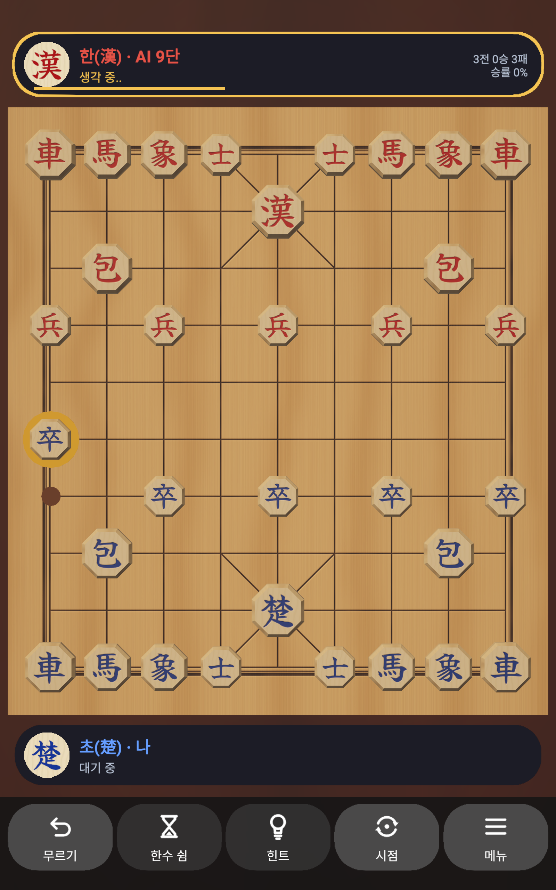
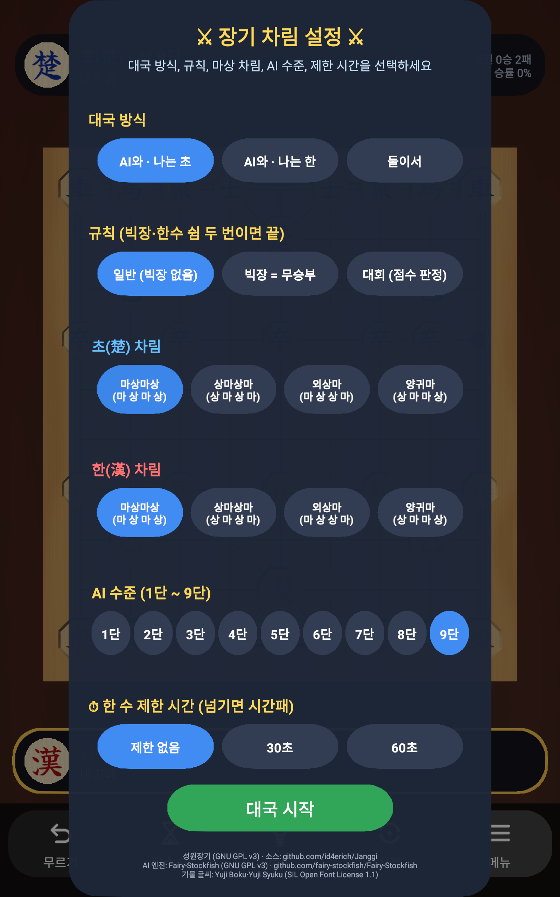
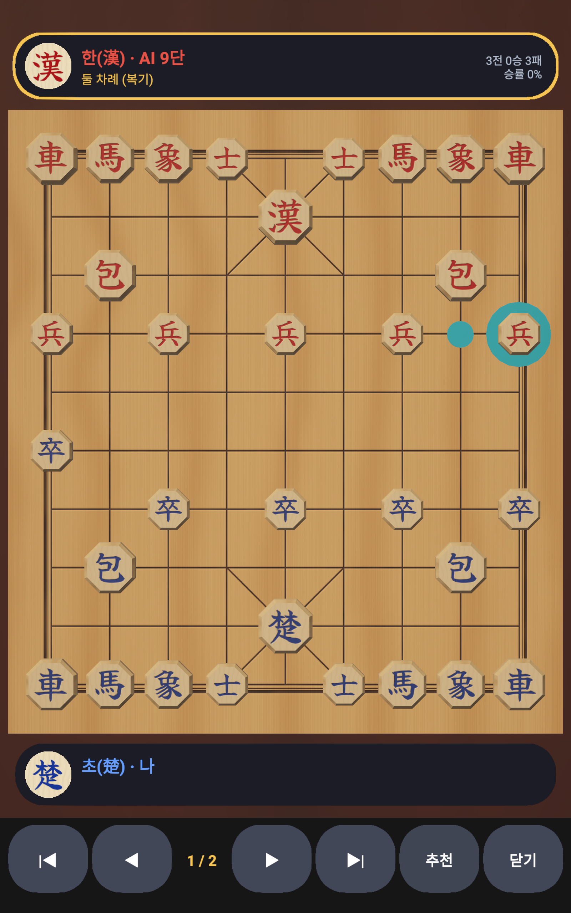
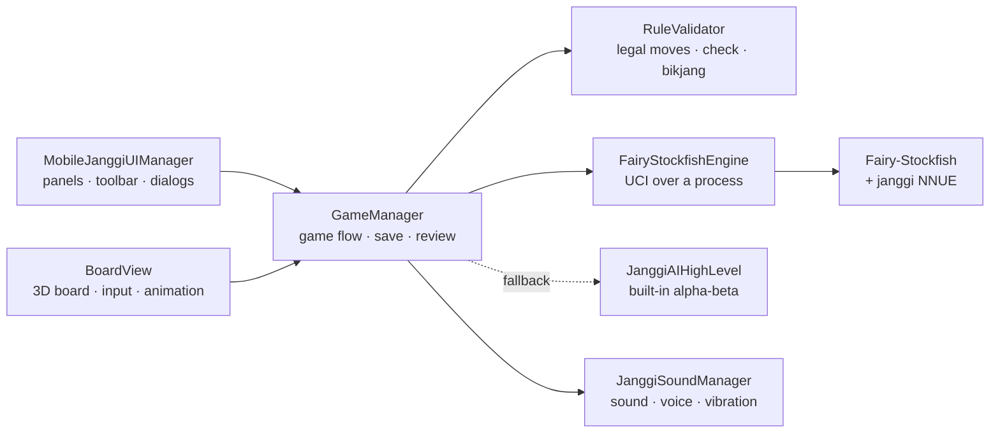

<div align="center">

# Seongwon Janggi (성원장기)

**A 3D Korean chess (janggi) app for Android, with Fairy-Stockfish and a janggi neural network as the AI opponent.**

**English** | [한국어](README.ko.md)

[](https://github.com/id4erich/Janggi/releases/latest)
[](https://github.com/id4erich/Janggi/actions/workflows/rule-check.yml)
[](LICENSE)
<br>
[](https://unity.com/)
[](https://learn.microsoft.com/dotnet/csharp/)
[](https://docs.unity3d.com/Packages/com.unity.render-pipelines.universal@latest)
[](https://github.com/id4erich/Janggi/releases/latest)
[](https://github.com/fairy-stockfish/Fairy-Stockfish)

&nbsp;
&nbsp;


</div>

## Contents

- [Highlights](#highlights)
- [Download](#download)
- [Features](#features)
- [Architecture](#architecture)
- [Project layout](#project-layout)
- [Getting started](#getting-started)
- [Testing](#testing)
- [Tools](#tools)
- [Building the engine](#building-the-engine)
- [Privacy](#privacy)
- [License](#license)

## Highlights

- **Strong, adjustable AI**: Fairy-Stockfish with the janggi NNUE runs on the device. Nine levels go from beginner to the engine's full strength.
- **Feels like real pieces**: 3D boxwood pieces on a wooden board, a wooden clack and vibration on landing, and drag-and-drop or tap-to-move.
- **Built for study**: hints, review mode with the engine's move for any position, and a shareable move record.
- **Verified rules**: the rule engine is checked against Fairy-Stockfish's move generator in CI.
- **Private and free**: no ads, no accounts, and nothing is sent over the network.

## Download

Get the latest APK from [**Releases**](https://github.com/id4erich/Janggi/releases/latest). It needs Android 7.1 or later on an arm64 device. To install it, allow "Install unknown apps" for your browser or file manager.

## Features

### Rules
- Korean janggi rules, including diagonal moves along the palace lines (General, Guards, Chariots, Cannons, Soldiers)
- Moves that leave your own General in check are rejected; checkmate ends the game
- Pass, undo and resign
- Three rule sets, matching Fairy-Stockfish's janggi variants so the AI plays by the same rules:

  | Rule set | Engine variant | Bikjang (facing Generals) | Two passes in a row |
  |---|---|---|---|
  | Casual | `janggicasual` | Not a rule | Draw |
  | Bikjang draw | `janggitraditional` | Must be broken, or accepted with a pass for a draw | Draw |
  | Tournament | `janggi` | Ends the game; decided by points | Ends the game; decided by points |

  Tournament points: Chariot 13, Cannon 7, Horse 5, Elephant 3, Guard 3, Soldier 2; Han gets a 1.5-point bonus.
- Optional move time limit (none / 30 s / 60 s); running out of time loses the game

### Game modes and setup
- Play as Cho or as Han against the AI (the board turns around when you play Han), or two players on one device
- Four Horse/Elephant setups, chosen separately for each side
- AI levels 1–9; level 9 is the engine at full strength

### AI
- [Fairy-Stockfish](https://github.com/fairy-stockfish/Fairy-Stockfish) runs as a separate process and talks to the app over UCI
- Evaluates positions with the janggi neural network from [Fairy-Stockfish-NNUE](https://github.com/fairy-stockfish/Fairy-Stockfish-NNUE)
- Uses half the CPU cores (up to 4) and a 64 MB hash
- Falls back step by step: if the network cannot be loaded it uses classical evaluation, and if the engine cannot run it uses a built-in alpha-beta AI. If the engine stops mid-game, the built-in AI takes over instead of passing.
- A gold bar under the AI's panel shows its thinking time, and the AI lifts its piece with a gold ring before moving

### Playing
- Tap a piece and then a target, or drag the piece to the target
- A wooden clack and vibration the moment a piece lands; move speed depends on distance; captured pieces are knocked aside
- Illegal targets make the piece shake, with a short vibration
- A red ring marks a General in check; the hint button shows the engine's suggested move
- Captured pieces appear as small icons in the capturing player's panel

### Review and records
- Move record with side, piece, coordinates and captures
- Share the move record as text through the Android share sheet
- Review mode: step through the game and ask the engine for its move in any position
- The game in progress is saved after every move and resumed when the app restarts, undo history included
- A win/loss record for games against the AI (two-player games are not counted), which can be reset in Settings

### Presentation
- Chamfered octagonal boxwood pieces with engraved brush-script characters, a wood-grain board and soft shadows
- A top-down view that fills the screen width, and an angled 3D view (the "view" button)
- Sound effects, voice lines and vibration can each be turned on or off; voice lines such as "Janggun!" use the device's TextToSpeech and work offline

The in-game text is in Korean.

## Architecture



The engine is started with `System.Diagnostics.Process` on PC and with `Runtime.exec` on Android. Requests run on a background thread so the screen never freezes while the AI thinks.

## Project layout

| Path | Contents |
|---|---|
| `Assets/Scripts/Core` | Rules (`RuleValidator`), game flow (`GameManager`), core types |
| `Assets/Scripts/AI` | Fairy-Stockfish integration (`FairyStockfishEngine`), built-in AI |
| `Assets/Scripts/View` | Board and piece rendering, input, animation, piece mesh generation |
| `Assets/Scripts/UI` | Mobile UI, camera |
| `Assets/Scripts/Audio` | Procedural sound effects, TextToSpeech voice lines, vibration |
| `Assets/Scripts/Editor` | APK build menu, EditMode tests |
| `Assets/Plugins/Android/libs/arm64-v8a` | Fairy-Stockfish and the janggi NNUE for Android |
| `Assets/Plugins/Android/AndroidManifest.xml` | Custom main manifest (Unity defaults plus the TTS engine query required on Android 11+ and the vibration permission) |
| `Assets/Resources/PieceArt`, `BoardArt`, `UIIcons` | Pre-baked piece, board and icon art |
| `Tools/FairyStockfish` | Windows engine and NNUE for the editor, AI level calibration script |
| `Tools/RuleCheck` | Checks the rule engine against Fairy-Stockfish move generation |
| `Tools/PieceArt` | Scripts that bake the piece, board and icon textures |
| `Tools/Fonts` | Brush-script fonts used only for baking textures (not shipped in the app) |
| `docs/store`, `docs/release-notes` | Store listing, screenshots and release notes |

## Getting started

### Requirements
- Unity 6000.3.16f1 with Android Build Support (URP)
- .NET SDK, for the rule check
- Python 3 with Pillow and NumPy, for the tool scripts

### Run in the editor
Open `Assets/Scenes/SampleScene.unity` and press Play. The editor uses the Windows engine and network in `Tools/FairyStockfish`.

### Build for Android
- **Test APK**: **Build → Build Android APK**. It is signed with the debug key and written to `Builds/Android/성원장기.apk`.
- **Release**: enter the keystore passwords in *Player Settings → Publishing Settings*, then build from *Build Profiles*. Turn on **Build App Bundle (Google Play)** for an `.aab`, or leave it off for a signed `.apk`.

## Testing

- **EditMode tests**: open *Window → General → Test Runner* and run the EditMode tests. They cover the rules, game flow, save and resume, review mode, the built-in AI and the engine integration.
- **Rule check (CI)**: [`rule-check.yml`](.github/workflows/rule-check.yml) runs on every change to the rule engine; see [Rule check against Fairy-Stockfish](#rule-check-against-fairy-stockfish).

## Tools

### Rule check against Fairy-Stockfish
`Tools/RuleCheck` plays random games and, at every position, compares the legal moves from the app's `RuleValidator` with Fairy-Stockfish's `go perft 1`. Pass moves are excluded because the app has a separate pass button.

```bash
cd Tools/RuleCheck && dotnet run -c Release -- 2026 200 janggitraditional
```

Arguments are the random seed, the number of games and optionally the variant (`janggicasual` by default, `janggitraditional`, `janggi`). At the time of writing, about 38,000 casual positions and 17,600 bikjang-rule positions matched exactly.

### AI level calibration
The per-level settings live in `GameManager.AiLevels`. The calibration script plays automatic games between adjacent levels with the PC engine and network, and reports the score and Elo difference.

```bash
python Tools/FairyStockfish/calibrate_levels.py --games 24 --time-scale 0.4
```

`--time-scale 0.4` scales the PC's thinking time to roughly match a phone (Galaxy S10). To compare raw engine skill levels instead of the app's levels, use `--ladder="-12:1000,-6:1000,0:1000"`.

### Re-baking piece and board textures

```bash
python Tools/PieceArt/bake_piece_textures.py
python Tools/PieceArt/bake_board_texture.py
```

The results are written to `Assets/Resources/PieceArt` and `Assets/Resources/BoardArt`. In Unity, set the Texture Type of the normal maps (`*_n.png`) to Normal map.

## Building the engine

### Android (arm64)
Build from the `src` folder of [Fairy-Stockfish](https://github.com/fairy-stockfish/Fairy-Stockfish) at commit [`9f778da`](https://github.com/fairy-stockfish/Fairy-Stockfish/tree/9f778da667f6e07dae1e85d3e2ea204fc6dee94d) (the version the janggi network requires), using the clang from the NDK (r27c) bundled with Unity.

```bash
"$NDK/toolchains/llvm/prebuilt/windows-x86_64/bin/clang++.exe" --target=aarch64-linux-android25 \
  -std=c++17 -stdlib=libc++ -fPIE -fno-exceptions -O3 -DNDEBUG -DIS_64BIT -DUSE_POPCNT -DUSE_NEON \
  -DLARGEBOARDS -DPRECOMPUTED_MAGICS -DNNUE_EMBEDDING_OFF -w \
  benchmark.cpp bitbase.cpp bitboard.cpp endgame.cpp evaluate.cpp main.cpp material.cpp misc.cpp \
  movegen.cpp movepick.cpp pawns.cpp position.cpp psqt.cpp search.cpp thread.cpp timeman.cpp tt.cpp \
  uci.cpp ucioption.cpp tune.cpp syzygy/tbprobe.cpp nnue/evaluate_nnue.cpp nnue/features/half_ka_v2.cpp \
  partner.cpp parser.cpp piece.cpp variant.cpp xboard.cpp nnue/features/half_ka_v2_variants.cpp \
  -static-libstdc++ -pie -lm -latomic -o libfairystockfish.so
```

Strip it with `llvm-strip` and place it in `Assets/Plugins/Android/libs/arm64-v8a/`. Android does not allow executing files from the app's data directory, so the engine is shipped under a `.so` name; the installer extracts it to the native library directory, where it may be executed.

### Windows (editor)
`Tools/FairyStockfish/fairy-stockfish-largeboard_x86-64-modern.exe` is built from the same source with the same NDK clang, targeting `x86_64-pc-windows-msvc` (MSVC itself has no 128-bit integers). Run it from a Visual Studio 2022 `vcvars64` prompt, with a copy of the NDK's `ld.lld.exe` named `lld-link.exe` (plus the NDK `bin` DLLs) on `PATH`:

```bat
clang++ --target=x86_64-pc-windows-msvc -fuse-ld=lld -std=c++17 -D_ALLOW_COMPILER_AND_STL_VERSION_MISMATCH -O3 -DNDEBUG ^
  -DIS_64BIT -DUSE_POPCNT -DUSE_SSE41 -DUSE_SSSE3 -DUSE_SSE2 -msse4.1 -mssse3 -mpopcnt ^
  -DLARGEBOARDS -DPRECOMPUTED_MAGICS -DNNUE_EMBEDDING_OFF -w -fms-extensions -Xclang -fcxx-exceptions ^
  (same source files) -o fairy-stockfish-largeboard_x86-64-modern.exe
```

### Neural network (NNUE)
The engine plays with `janggi-9991472750de.nnue` from [Fairy-Stockfish-NNUE](https://github.com/fairy-stockfish/Fairy-Stockfish-NNUE). It also serves `janggicasual` and `janggitraditional`, but only under a file name that starts with `janggi`. The PC copy is `Tools/FairyStockfish/janggi-9991472750de.nnue`. On Android it ships as `Assets/Plugins/Android/libs/arm64-v8a/libjanggi_nnue.so` and is copied once to the app's data folder under its original name.

## Privacy

The app collects no personal data and sends nothing over the network. See [`PRIVACY.md`](PRIVACY.md).

## License

Seongwon Janggi is licensed under the [GNU GPL v3](LICENSE).

Third-party components included in the app or used to build it:

| Component | License | Source |
|---|---|---|
| Fairy-Stockfish | GNU GPL v3 | [fairy-stockfish/Fairy-Stockfish](https://github.com/fairy-stockfish/Fairy-Stockfish) (`Tools/FairyStockfish/Copying.txt`) |
| Janggi NNUE (`janggi-9991472750de.nnue`) | GNU GPL v3 | [fairy-stockfish/Fairy-Stockfish-NNUE](https://github.com/fairy-stockfish/Fairy-Stockfish-NNUE) |
| Yuji Boku, Yuji Syuku fonts | SIL Open Font License 1.1 | `Tools/Fonts/OFL-*.txt` (used for baking textures only) |

Because the APK contains the engine and the network, any distribution of the app must include the GPL v3 notice and point to their source. In the app, these notices are shown at the bottom of the setup dialog.
